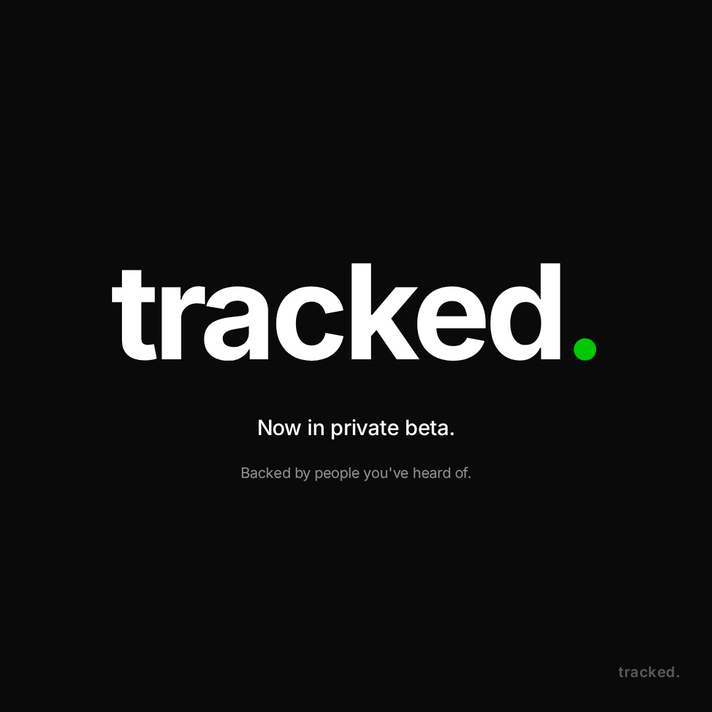

# tracked.

> a tracker app. for things. now in private beta. backed by people you've heard of.

<p align="center">
  <a href="brag.mp4"></a>
</p>

<p align="center"><em>↑ click the poster to play the 18s launch promo</em></p>

---

## what this is

An 18-second product launch promo for **`tracked.`** — a fictional tracker app. Built following the [`/brag-slim`](https://github.com/latent-spaces/brag/blob/main/skills/brag/slim.md) creative playbook from [latent-spaces/brag](https://github.com/latent-spaces/brag).

The full `/brag` workflow hands off to [Hyperframes](https://hyperframes.heygen.com/) for rendering. This repo used the **brag-slim** path instead — same creative laws, same deliverables, but rendered entirely on-machine with FFmpeg + Playwright + TTS.

| spec | value |
|---|---|
| format | square 1080×1080 @ 30fps |
| duration | 18.0s |
| tone | `yc-parody` (deadpan 2016 Series A startup energy) |
| voiceover | `jam` (British gentleman) via z-ai TTS |
| music | procedurally synthesized A-minor pad (numpy + scipy) |
| scenes | 6, hard cuts between them |

## storyboard

| # | scene | duration | content |
|---|---|---|---|
| 1 | hook | 0.0–2.5s | pure black, "we built a thing." fades up |
| 2 | reveal | 2.5–5.5s | `tracked.` brand + tagline |
| 3 | list | 5.5–9.0s | browser UI mockup with three tracked items appearing one by one |
| 4 | toast | 9.0–12.0s | simulated click + "Saved." toast slides up |
| 5 | chart | 12.0–15.0s | green line draws itself up-and-to-the-right |
| 6 | punchline | 15.0–18.0s | `tracked.` + "Now in private beta." + "Backed by people you've heard of." |

Full plan with creative-laws checklist: [`brag-plan.md`](brag-plan.md). Postable share copy: [`share-copy.txt`](share-copy.txt).

## repo layout

```
.
├── brag.mp4            ← the video (click to preview in GitHub's inline player)
├── brag.jpg            ← poster frame (also baked as frame 0 of brag.mp4)
├── brag-plan.md        ← full creative plan + storyboard
├── share-copy.txt      ← postable share copy, 4 cuts
├── scenes/             ← 6 source HTML files, one per scene (pure functions of time via --t CSS var)
└── scripts/            ← brag_capture.js (Playwright), brag_vo.sh (TTS), brag_audio.py (mix)
```

## re-rendering

```bash
# capture frames at 30fps (assumes Node + playwright)
BRAG_OUT=$(pwd) node scripts/brag_capture.js

# generate 5 TTS voiceover lines (assumes z-ai CLI)
BRAG_OUT=$(pwd) bash scripts/brag_vo.sh

# synthesize music + SFX + final mix (assumes python3 + numpy + scipy)
BRAG_OUT=$(pwd) python3 scripts/brag_audio.py

# encode the mp4 (poster baked as frame 0)
ffmpeg -y -framerate 30 -i work/frames/f%04d.png \
  -i work/audio/mix.wav \
  -c:v libx264 -preset fast -crf 20 -pix_fmt yuv420p \
  -c:a aac -b:a 192k -movflags +faststart -shortest brag.mp4
```

## credits

- Creative playbook: [`/brag-slim`](https://github.com/latent-spaces/brag) by latent-spaces
- Voice: `jam` (英音绅士) via [z-ai-web-dev-sdk](https://www.npmjs.com/package/z-ai-web-dev-sdk) TTS
- Rendering: FFmpeg 7.1 + Playwright 1.63 (bundled chromium)
- Audio synthesis: numpy + scipy
- Type: Inter (loaded from Google Fonts at capture time)

## license

The `/brag` playbook is upstream MIT-style — see the [original repo](https://github.com/latent-spaces/brag). This repo's scene HTML, scripts, and video are released under the same spirit: take, fork, re-roll.
